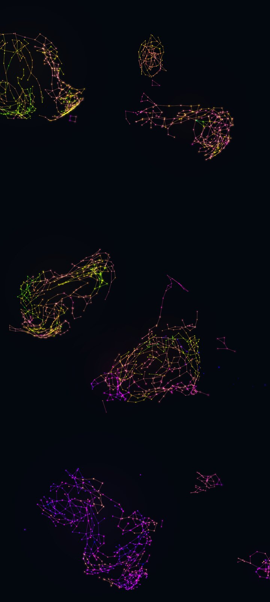

<div align="center">

# Doros

### A living wallpaper by Lee Daghlar Ostadi

Dots that bond, keep rhythm, fuse and divide, and whose rules evolve.

[Build it yourself](docs/BUILDING.md) · [The equations](docs/DYNAMICS.md) · [Privacy](docs/PRIVACY.md)

</div>

Doros turns an Android home screen into a small world that is never drawn,
only grown. Nothing in it is a prescribed shape. Every glowing dot obeys the
same few equations:
- **Bonds:** a dot bonds to nearby dots up to its valence, more readily when they share its rhythm and colour.
- **Springs:** a bond is a spring that breathes with that rhythm and snaps when stretched or out of step.
- **Sharing:** rhythm, colour, spin and depth spread along bonds.
- **Motion:** each dot gathers toward dots in step with it, circles the density it feels, swims, and drifts in the current of a hidden Game of Life world.

Bodies grow out of those rules on their own, with crystal cores, lacy rims and spiral arms. So do synchrony, fusion and division. Every line you see is a bond between two dots.

The rules are not fixed either. A dot's colour is its kind: it sets how long
its bonds like to be, how hard it breathes, how many bonds it holds, how fast
it swims and how heavy it is. Colours flow as gradients and drift, each lineage
keeping its own, so the rules that drive each dot keep changing as the system
evolves. Vertices crowded past what their bonds can hold glow red and push
apart, so crowded clusters unfold into new shapes instead of collapsing; and
the screen is a window onto a larger pond that groups drift into and out of.

<p align="center"></p>

*An offscreen Android render at full phone resolution (1280 × 2856), 150 pond seconds after a random start, run at Drift 0.5 to get there sooner. Not a photograph of a phone.*

The name puts a **D**, for *dynamic*, in front of *-oros*, from *kairos*: the right moment.

## What you see

- **Bodies that make themselves.** Each lineage starts as a loose random cloud. Its dots knit into an open lattice within seconds, and bodies take on rings, loops, crescents, curled arms and webs. Dots that can hold more bonds sort into crystal cores; dots that hold two or three make nets and lacy rims.
- **No collapse.** A continuous exclusion principle stops any body crushing itself: the pull together fades as packing nears critical and pushes apart beyond it.
- **Heat.** A vertex crowded per bond it holds glows red, its most repulsive state. Hot vertices push apart and link outward to cool ones, so clusters unfold and cool as they spread.
- **Fusion and division without a script.** Bodies that fall into step attract and knit together. When their rhythms can no longer stay locked they drift apart again, and quorum sensing loosens any body that grows too large.
- **Colour is kind.** Colour sets bond length, breathing, valence, swimming and mass. Every dot is drawn in its exact colour and every bond is a gradient between its dots, so colour moves through bodies steadily. Each lineage keeps its own drifting colour, so fused bodies show patches of their lineages.
- **An open frame.** Groups of different sizes, shapes, densities, speeds and colours slide in from beyond the edges, and parts of bodies drift out; the pond keeps within a few percent of its size.
- **Unison.** Dots move to their own rhythm, so a body in step strokes and swells as one, with waves from its core. A slowly turning projection from two hidden dimensions makes forces come and go.
- **Depth.** Near bodies are larger and brighter. Each body is drawn as a slowly rocking, tilted dome, and home-page swipes shift near bodies farther than far ones.
- **Touch.** Drag to move and fling dots; tap and they startle outward in one bright beat.
- **A companion.** Tap the wallpaper and nearby dots come to look, more eagerly the more you play. Come back after a while and they gather to meet you. They are calmer at night and sleepy on a low battery. With **Know my day**, the colours of the apps you spent time in arrive in the water when you return. That is read on the phone only; Doros has no internet permission.

## Controls

- **Drift** sets the pace. Physics runs in fixed steps of simulated time, so its work follows Drift rather than the display rate.
- **Shape evolution** sets how fast lattices rebuild and rules wander.
- **Color drift** moves the palette.
- **Lineages** (1 to 9, about 270 dots each), **Merging**, **Collisions** and **Let crowding vary** shape the population.
- **Pattern influence** sets how strongly the hidden Life current carries the dots. **1 Hz** or **4 Hz** sets the pace of Life generations.

Defaults are calm: Drift 0.11×, Shape evolution 0.10×, Color drift 0.41×,
seven lineages, 1 Hz.

## Battery

Doros pauses whenever it is hidden. It draws at 60 fps only while you touch the
screen, then 24 fps (20 in Battery Saver or on a low battery). Between drawn
frames it sleeps instead of waking for every display refresh. Measured on the
author's phone during a real home-screen visit, the wallpaper's main thread
spent about 4 ms per frame: roughly a quarter of one CPU core while touched at
60 fps, and a tenth of a core at the idle 24 fps.

## Build and verify

Doros is Java with Android framework APIs and Python standard-library build
tools: no Gradle, Maven or third-party runtime dependencies.

```sh
python3 tools/test.py                       # eight simulation test suites
python3 tools/build.py --out dist           # unsigned APK
python3 tools/verify_reproducible.py        # tests + two clean builds, byte-compared
```

See [docs/BUILDING.md](docs/BUILDING.md) for the toolchain and signing. The
simulation suites check, among other things, that:
- **Lattice bookkeeping:** every bond is recorded exactly.
- **Motion:** stays finite, calm, and within the frame and its margin.
- **Emergence:** the lattice builds itself, and bodies keep fusing and dividing.
- **No collapse:** no body takes over the pond, and loose dust stays rare.
- **Evolving rules:** colours, and with them properties, keep changing and stay within bounds.
- **Heat:** crowded vertices run hotter than calm ones; hot vertices stay a minority.
- **Open frame:** groups arrive, dots leave and cross the edges both ways, and the pond keeps its size.
- **Allocation:** a simulation step allocates nothing.

`tools/DorosProbe.java` renders real Android frames on a device and measures screen coverage, events, bond lengths, tap response and cost.

## License

Copyright (C) 2026 Lee Daghlar Ostadi.

Doros is free software: you can redistribute it and/or modify it under the
terms of the GNU General Public License as published by the Free Software
Foundation, either version 3 of the License, or (at your option) any later
version. It is distributed without any warranty. See [LICENSE](LICENSE).
